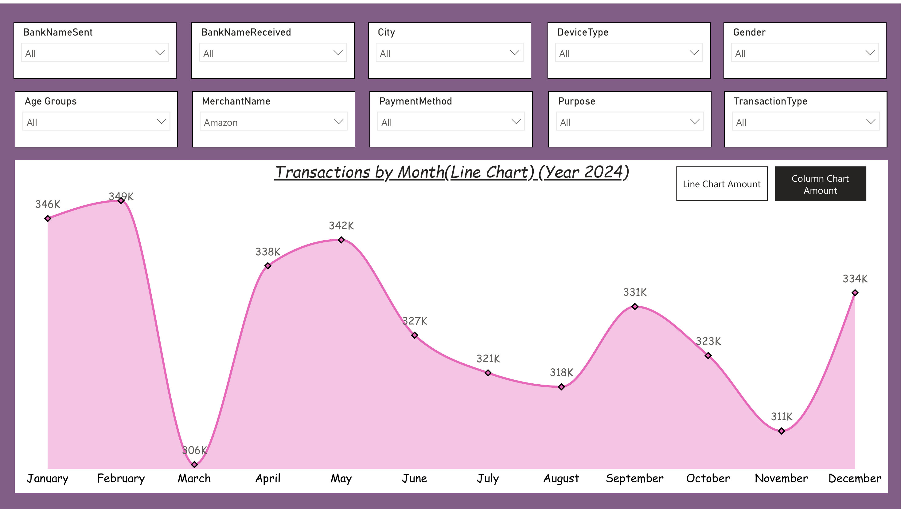
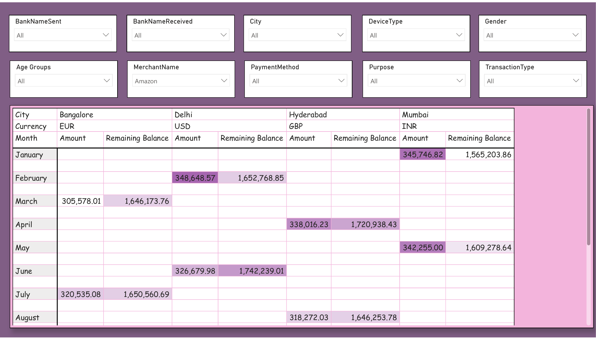

# UPI Transaction Data Analysis — Power BI

An interactive Power BI report on **20,000 UPI (Unified Payments Interface) transactions from 2024**. It tracks monthly transaction value and lets you slice by bank, city, device, customer gender and age group, merchant, payment method, purpose and transaction type.



## Business questions
- How does UPI transaction value change month by month across 2024?
- How do value and balances differ by city, merchant, bank or customer group?
- Which transactions fail, and where?

## Tools
- **Power BI Desktop & Service** – Power Query, date hierarchy, calculated column, bookmarks, report

## Data
`data/upi_transactions.xlsx` – 20,000 rows, 20 columns (1 Jan – 30 Dec 2024)

| Column | Example |
|---|---|
| TransactionID, TransactionDate, TransactionTime | TXN00001, 2024-02-02, 17:12:14 |
| Amount, RemainingBalance, Currency | 271.64, 5,557.02, USD |
| BankNameSent, BankNameReceived | SBI, HDFC, ICICI, Axis |
| City | Bangalore, Delhi, Hyderabad, Mumbai |
| Gender, CustomerAge | Female, 21 (ages 20–59) |
| TransactionType, Status, PaymentMode | Transfer / Payment, Success / Failed, Instant / Scheduled |
| DeviceType, PaymentMethod | Mobile / Tablet / Laptop, UPI ID / QR Code / Phone Number |
| MerchantName, Purpose | Amazon, Swiggy, Zomato, IRCTC, Flipkart / Food, Travel, Shopping… |

In Power BI I added an **Age Groups** column from CustomerAge.

## Report
**Page 1 – Transactions by month.** A line chart and a column chart of total amount by month. Two **bookmark buttons** switch between the line and column views.

**Page 2 – City × currency matrix.** Amount and remaining balance by month, split by city and currency, with conditional formatting.

**Both pages** have 10 slicers: Bank Sent, Bank Received, City, Device Type, Gender, Age Group, Merchant, Payment Method, Purpose and Transaction Type.

| Page 1 | Page 2 |
|---|---|
|  |  |

*Screenshots are filtered to the merchant **Amazon**.*

## Key findings
- **Total value: 19.87M** across 20,000 transactions, averaging about 994 each.
- **Monthly value is steady**, at 1.60M–1.71M every month. The peak is **May (1.71M)** and the low is **August (1.60M)**. For Amazon alone, February is highest (349K) and March is lowest (306K).
- **20% of transactions failed (4,000).** Every failed transaction is a **Flipkart / Shopping** payment, and no Flipkart transaction succeeded. In a real business, this would point to a problem with one merchant's integration rather than a general UPI issue.

## Data quality checks
- **Mixed currencies:** UPI payments are made in Indian rupees, but the data has amounts in INR, USD, EUR and GBP (5,000 rows each). Adding them together mixes currencies. They should be converted to INR first, or the report filtered to one currency.
- **Failed transactions in totals:** the totals include the 4,000 failed transactions (4.0M). For "money actually moved", filter on Status = Success, which gives 15.88M.
- **Remaining balance is summed:** balance is a point-in-time value, so adding it up across transactions doesn't mean much. An average or latest balance per customer would be more useful.
- **Synthetic data:** every category has exactly the same number of rows, and some columns always move together (e.g. Bangalore is always EUR, Delhi always USD, Amazon is always "Food"). Patterns in the charts reflect how the data was generated, not real customer behaviour.
- **Account numbers:** the data includes customer and merchant account numbers. They are fake here, but in real data these columns should be masked before sharing.

## Repository structure
```
├── powerbi/   UPI_Transaction_Data_Analysis.pbix, UPI_Transaction_Data_Analysis.pdf
├── data/      upi_transactions.xlsx
└── images/    report page screenshots
```

## How to open
Download `powerbi/UPI_Transaction_Data_Analysis.pbix` and open it in Power BI Desktop (free). Use the slicers and the two bookmark buttons on page 1.

---
**Author:** Vaishali Kedare · [LinkedIn](https://www.linkedin.com/in/vaishali-kedare-8a8b67215)) · [GitHub](https://github.com/vaishalikedare)
